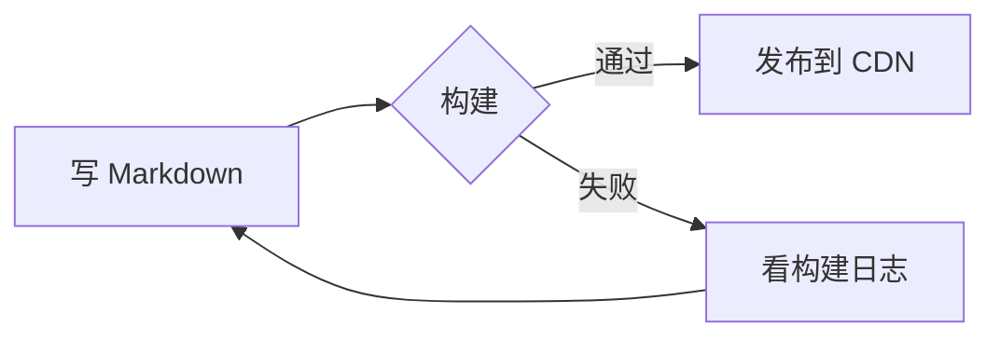
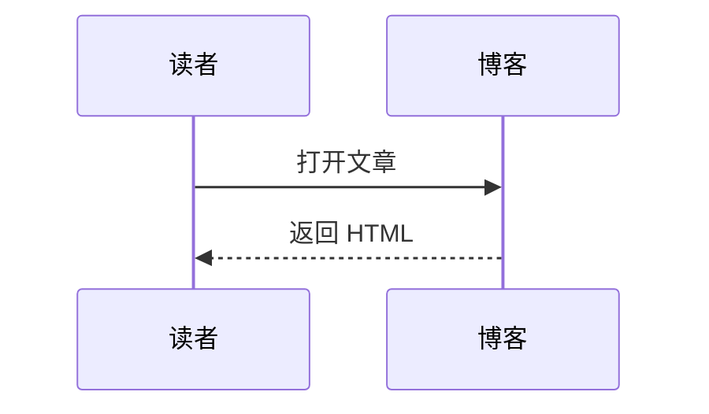

写博客最麻烦的往往不是想法，而是「这段该用什么语法」。这篇文章把本站支持的 Markdown 写法整理成一份速查表，内容本身就是可运行的示例——看到的效果就是语法渲染出来的样子。

## 基础语法

### 标题

用 `#` 到 `######` 表示一到六级标题。正文里建议从 `##` 开始，`#` 留给文章标题；右侧「文章目录」会自动收集二、三级标题。

```markdown
## 二级标题
### 三级标题
```

### 强调与行内代码

**加粗**、*斜体*、~~删除线~~、`行内代码`，也可以组合：**加粗里的 `代码`**。

```markdown
**加粗**、*斜体*、~~删除线~~、`行内代码`
```

### 链接与图片

站内链接写相对路径，站外链接会在新标签页打开：[Astro 文档](https://docs.astro.build)、[关于我](/about/)。

图片用 ``，文章配图统一上传到图床后用完整 URL 引用（图标、壁纸这类站点资源才放在 `public/` 或 `src/assets/`）：


```markdown
[文字](https://example.com)

```

### 列表

- 无序列表用 `-`、`*` 或 `+`
- 嵌套列表缩进两格或四格
  - 像这样
- 有序列表用 `1.` `2.`

1. 第一步
2. 第二步

任务列表（GitHub 风格）：

- [x] 已经做完的事
- [ ] 还没做完的事

### 引用与分割线

> 引用用来放摘录。
>
> 也可以有多段。

```markdown
> 引用内容
---
```

### 换行与转义

段落之间空一行；段落内换行需要行尾加两个空格。想原样显示 `*`、`_`、`#` 等符号时，用反斜杠转义：\*不是斜体\*。

## 表格

表头与内容之间用 `---` 分隔，冒号控制对齐：

| 语法 | 对齐 | 说明 |
| :--- | :---: | ---: |
| `:---` | 左对齐 | 默认 |
| `:---:` | 居中 | 常用 |
| `---:` | 右对齐 | 数字 |

```markdown
| 左 | 中 | 右 |
| :--- | :---: | ---: |
| a | b | c |
```

## 代码块

用三个反引号包裹代码，并在开头标注语言。代码块带行号、语言徽章和右上角复制按钮；超过 15 行会自动折叠，点「展开」看全文。

```js
export function greet(name) {
  return `你好，${name}`;
}
```

行内命令或变量用单个反引号：`pnpm dev`。

写一段长一点的代码，可以观察自动折叠的效果（下面这段 17 行）：

```js
export function buildPost({ title, tags, body }) {
  const meta = {
    title,
    tags,
    published: new Date(),
    draft: false,
    comment: true,
  };

  const lines = body.split("\n");

  return {
    ...meta,
    body: lines.map((line) => line.trimEnd()).join("\n"),
  };
}
```

````markdown
```js
const a = 1;
```
````

## 提示块

用引用语法加类型标记，支持 GitHub 风格的提示块：`NOTE`、`TIP`、`IMPORTANT`、`WARNING`、`CAUTION`。

> [!NOTE]
> 这是 NOTE，用来补充说明。

> [!TIP]
> 这是 TIP，放一点小技巧。

> [!IMPORTANT]
> 这是 IMPORTANT，强调必须知道的事。

> [!WARNING]
> 这是 WARNING，提醒可能的坑。

> [!CAUTION]
> 这是 CAUTION，用于危险操作。

```markdown
> [!NOTE]
> 内容是 Markdown，可以换行、加列表、放代码。
```

## 数学公式

行内公式用 `$...$`，独立公式用 `$$...$$`，由 KaTeX 渲染：

行内：当 $a \ne 0$ 时，方程 $ax^2 + bx + c = 0$ 的两个根为 $x = \frac{-b \pm \sqrt{b^2-4ac}}{2a}$。

独立公式：

$$
\sum_{i=1}^{n} i = \frac{n(n+1)}{2}
$$

```markdown
行内 $E = mc^2$

$$
\int_0^1 x^2 \, dx = \frac{1}{3}
$$
```

## Mermaid 图表

用 `mermaid` 代码块画流程图、时序图，构建时会渲染成静态 SVG：



时序图：



## 图片网格

多张图片并排时，用 `[grid]` 包起来，列数按图片数量自动排：

[grid]


[/grid]

```markdown
[grid]


[/grid]
```

## Wiki 链接

Obsidian 风格的 `[[文章]]` 可以按文件名链接到其他文章，支持 `[[文件名|显示文字]]`：

[[webdav-self-hosted|在服务器上搭一个 WebDAV]]

```markdown
[[webdav-self-hosted]]
[[webdav-self-hosted|在服务器上搭一个 WebDAV]]
```

## 文章 Frontmatter

每篇文章开头用 `---` 包住一段 YAML，决定标题、时间、分类这些信息：

```yaml
---
title: 文章标题
published: 2026-11-01T20:20:00+08:00   # 建议带时区，避免日期显示偏一天
description: 列表和搜索结果里显示的一句话简介。
image: ""          # 封面图，留空则不显示
tags: [Markdown, 写作]
category: 教程
draft: false       # true 则只在开发环境可见
pinned: false      # 置顶
comment: true      # 是否允许评论（需先启用评论系统）
---
```

文件名就是 URL：`src/content/posts/markdown-guide.md` 对应 `/posts/markdown-guide/`。

## 写作小贴士

- 一篇只用一个 `#`（文章标题），正文从 `##` 开始，目录更清爽；
- 代码块一定写语言，徽章和高亮都靠它；
- 长文章多用二级标题分段，读者可以顺着目录跳；
- 图片放 `public/` 用绝对路径引用，避免相对路径在列表页失效；
- 写完跑一次 `pnpm build`，构建能过基本就没问题。

---

以上就是本站的 Markdown 写法。语法不用全记住，用到时回来查一眼就够了。
